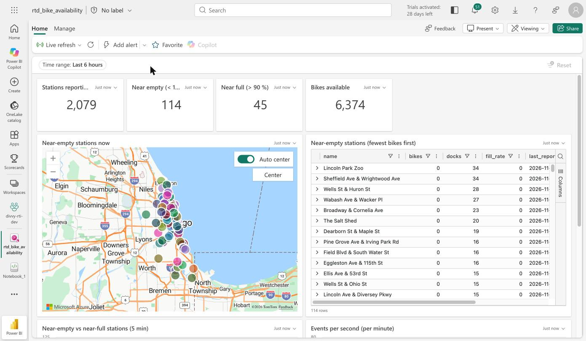
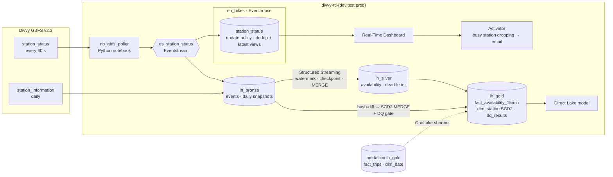
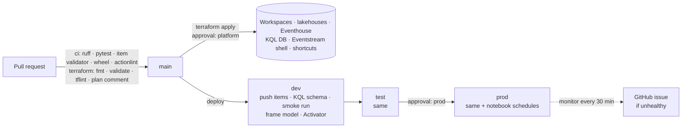

# Fabric Real-Time Bike Availability — Streaming · CDC/SCD2 · CI/CD

[](https://github.com/felipecastro-data/fabric-real-time-bike-availability/actions/workflows/ci.yml)
[](https://github.com/felipecastro-data/fabric-real-time-bike-availability/actions/workflows/deploy.yml)
[](https://github.com/felipecastro-data/fabric-real-time-bike-availability/actions/workflows/terraform.yml)
[](https://github.com/felipecastro-data/fabric-real-time-bike-availability/actions/workflows/monitor.yml)
[](LICENSE)

> **Status:** built and deployed to dev / test / prod by CI. The 7-day 24/7 prod run is scheduled for
> **2026-11-28 → 12-05**; measured results follow it. Progress: [docs/PLAN.md](docs/PLAN.md).

A streaming platform on **Microsoft Fabric Real-Time Intelligence** for Chicago's **Divvy** bike share. Operations see
which stations are running empty or full, within seconds, and get an email when a busy station is about to run dry.
Analysts get availability history keyed to **station versions (SCD2)** that stay correct through renames and moves,
joined to a year of trips from the batch counterpart,
[fabric-medallion-cicd-terraform](https://github.com/felipecastro-data/fabric-medallion-cicd-terraform).
Everything is provisioned with Terraform and deployed by GitHub Actions as a service principal over OIDC, with no
secrets for cloud access.

| At a glance | |
|---|---|
| Source | Divvy GBFS v2.3 `station_status`, polled every 60 s: **2,079 stations**, up to ~3M events/day |
| Hot path | Eventstream → Eventhouse (KQL): poll → queryable **p50 ≈ 1 s** (dev). Real-Time Dashboard + Activator email alert. |
| Warm path | Eventstream → Delta Bronze → Spark Structured Streaming → Silver (deduplicated, dead-letter) → Gold 15-minute fact |
| CDC / SCD2 | Daily `station_information` snapshot → hash-diff → `dim_station` versions dated by the **feed's** `last_updated` |
| Delivery | 3 workspaces (Terraform) · CD dev → test → **prod with approval**, with a smoke run of the whole pipeline in every stage · 30-min prod health monitor |
| Quality | 48 unit tests (local Spark + Delta, recorded GBFS fixtures) · data-quality gate (SCD2 invariants, Bronze = Silver + dead-letter, dead-letter rate, freshness) |



## Architecture





## What makes it production-grade

- **Two paths, each on the engine built for it.** KQL for seconds-fresh state and alerts; Delta + Spark for replayable,
  exactly-once history ([ADR 0002](docs/adr/0002-dual-sink-eventhouse-and-delta.md)).
- **Idempotent end to end.**
  - The poller is stateless and pushes every station
    ([ADR 0003](docs/adr/0003-push-full-snapshots-dedupe-downstream.md)).
  - KQL and Silver deduplicate on `(station_id, last_reported)` with insert-only MERGEs.
  - Gold windows are written once per `(station_id, window_start)`.
  - Unit tests prove that a two-part run plus a replayed batch equals a one-shot run.
- **Nothing is silently dropped.** Bad events go to `availability_deadletter` with a reason code. Stale stations are
  flagged, not removed, because the source really does have them.
- **CDC without a change feed.** SCD2 is found by hash-diffing daily snapshots, with versions dated by the feed, so a
  replay rebuilds identical history ([ADR 0004](docs/adr/0004-scd2-dated-by-feed-time-via-hash-diff.md)). A
  data-quality gate checks the SCD2 invariants on every run.
- **One set of definitions, every stage.** Notebooks, Eventstream, KQL schema, dashboard, semantic model and Activator
  live in Git with `{{…}}` placeholders. CI fills in each stage's IDs and proves the stage with a smoke run before the
  next one ([ADR 0006](docs/adr/0006-ownership-terraform-vs-rest-deploy.md)).
- **No secrets for cloud access.** GitHub OIDC → Entra service principal. Notebooks get Entra tokens for the Eventstream
  endpoint, with no connection strings. The only personal value (the alert email) is a GitHub secret, because this repo
  is public.
- **Operable.**
  - Prod schedules are owned by the service principal and end on a date.
  - A monitor opens a GitHub issue if polls stop for 15 minutes or the hourly stream fails.
  - Every notebook writes a JSON run record.

## What the gates caught

| Found by | Problem | Fix |
|---|---|---|
| Run-record check in dev | Fabric's older delta-rs **ignores the overwrite predicate**: the daily snapshot replaced the whole table and deleted the previous day | Delete-day + append; the run fails if other days' row count changes; reproduced locally on both delta-rs versions |
| Deploy to a fresh test workspace | The KQL external table over `dim_station` couldn't infer its schema without a Delta table | Explicit schema, plus a unit test that keeps it equal to the Spark schema |
| CI Terraform apply | `fabric_item_job_scheduler` rejects Notebook items (provider 1.15.1) | Schedules applied through the REST API by the prod deploy ([ADR 0006](docs/adr/0006-ownership-terraform-vs-rest-deploy.md)) |
| Eventstream smoke test | Batches of 256 KB and 1 MB timed out on AMQP and nothing landed | Batches capped at 64 KB |
| KQL schema script | Streaming ingestion can't run a transactional update policy that calls `ingestion_time()` | Non-transactional policy |
| Activator setup | Chart tiles allow at most 100 series (1,172 rows failed), and table tiles can't alert at all | The alert tile shows the 100 lowest values as a column chart ([ADR 0005](docs/adr/0005-activator-on-a-kql-query.md)) |
| Spark on OneLake | `createIfNotExists` on an existing path fails with `SCHEMA_NOT_FOUND` | Check `isDeltaTable` first |

## Results

Measured so far (dev, test and the first prod deploy, 2026-11-12 → 11-13):

| Metric | Value |
|---|---:|
| Stations per poll | 2,079 (1,178 classic + 901 lightweight) |
| Distinct states / events pushed | 57 % (3,569 / 6,237, dev) |
| Poll → queryable in KQL | p50 1.1–1.4 s · p95 2–20 s |
| Silver vs Bronze | 6,199 Silver = Bronze distinct `(station_id, last_reported)`; dead-letter 0 |
| Trips bridge coverage | 1,178 of 2,079 stations; **95.9 %** of Sept 2026 station trips start at a current station ([ADR 0007](docs/adr/0007-station-key-bridge-short-name.md)) |
| Prod smoke run (as the service principal) | snapshot 40 s · 3-min poll 182 s · Silver 162 s · SCD2 + DQ 142 s |

**7-day prod run (2026-11-28 → 12-05):** events/day raw vs deduplicated, events/s, latency p50/p95 per hop, dead-letter
rate, SCD2 changes caught, capacity units, alerts sent. These are added here after the run.

## Repository layout

```
src/divvy_rti/        GBFS client, poll loop, Silver/Gold streaming, SCD2 dim_station, DQ gate (typed, tested)
tests/                pytest + chispa, local Spark 3.5 + Delta 3.2, recorded GBFS fixtures
fabric/               Item definitions: 4 notebooks, Eventstream, dashboard, semantic model, Activator
kql/schema.kql        Eventhouse tables, update policy, materialized views, retention, functions
infra/terraform/      Workspaces, lakehouses, Eventhouse, KQL DB, Eventstream shell, shortcuts (HCP state)
infra/prod_schedules.json  Prod notebook schedules (applied by the prod deploy)
tools/                fabric_ops.py (push, run, kql, refresh, schedule, monitor), deploy_stage.sh, item validator
docs/                 PLAN, design.md, adr/, screenshots/
.github/workflows/    ci, terraform, deploy (dev → test → prod), monitor, fabric-run
```

## Run it

```bash
make check   # ruff, pytest (local Spark), Fabric item validator, wheel build — what the `ci` gate runs
```

Against a workspace, as your Azure CLI identity:

```bash
uv run --no-project python tools/fabric_ops.py run <workspace-id> nb_gbfs_poller '{"duration_minutes": "3"}'
```

A new environment is `terraform apply` (in `infra/terraform`) followed by one `deploy` run.

## Docs

- [docs/PLAN.md](docs/PLAN.md): plan, decisions and the dated progress log with every measurement.
- [docs/design.md](docs/design.md): scalability, cost, governance, security.
- [docs/adr/](docs/adr/): 7 architecture decision records.
