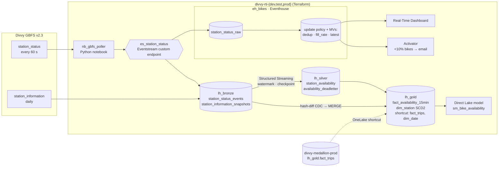

# Project plan & progress

**Progress: Step 1 in progress — 0 of 8 steps done (Step 1 ≈ 30 %)**

Fabric Real-Time Bike Availability: a streaming + CDC/SCD2 platform on the Divvy domain. Operations see which
Chicago stations are about to run empty or full, minutes ahead; analysts get station history (renames, capacity
changes, moves) that stays correct over time. It pairs with the batch medallion in
[fabric-medallion-cicd-terraform](https://github.com/felipecastro-data/fabric-medallion-cicd-terraform) on the same
domain (batch + streaming pair).

## Decisions taken (2026-11-11)

| Topic | Decision | Why |
|---|---|---|
| Poller runtime | Fabric **Python notebook** (non-Spark), loops ~55 min at 60 s, rescheduled hourly by Terraform | No Azure subscription on the tenant; stays 100% Fabric + Terraform |
| Workspaces | New `divvy-rti-dev/test/prod`, own HCP Terraform workspace `fabric-rti-platform`, own deployment pipeline | Repos stay independent; medallion Gold is read through OneLake shortcuts |
| Alert channel | Activator → **email** | Simplest to set up and evidence |
| Prod streaming window | **7 days 24/7**, then pause; dev/test run bounded sessions only | Trial capacity (FTL64, started 2026-10-13) likely ends ~2026-12-12 |
| CI identity | Reuse Entra app `sp-fabric-medallion-cicd`; add federated credentials for this repo | Already allowed by tenant settings + `sg-fabric-automation`; no secrets |

## Source facts (measured 2026-11-11, not assumed)

- GBFS discovery `https://gbfs.divvybikes.com/gbfs/gbfs.json` → Lyft-hosted `gbfs.lyft.com/gbfs/{1.1|2.3}/chi/`.
  Use **v2.3** (`vehicle_types_available`). `ttl = 60`, ETag + Last-Modified headers present.
- **2,079 stations** (not ~1,700): 1,178 `classic` + 901 `lightweight`. `station_status` 763 KB, `station_information` 1.1 MB.
- Volume if every station is pushed every poll: 2,079 × 1,440 ≈ **3.0M events/day, ~90M/month**. Real state
  changes (new `last_reported`) are far fewer — measure the dedup ratio and report both.
- Some stations report a `last_reported` from 2025 → stale reporters; flag them, don't drop them.
- **Join key to trips:** trip `start_station_id` (e.g. `CHI00307`) = GBFS **`short_name`**, not `station_id`
  (a 19-digit number). The 901 `lightweight` stations have **no `short_name`** → no trip join by key. Report coverage.

## Architecture



**Hot path (seconds):** poller → Eventstream → Eventhouse. KQL update policy computes `fill_rate =
bikes / (bikes + docks)` and flags; materialized views dedupe on `(station_id, last_reported)` and keep the latest
state per station. Retention 30 days, hot cache 7 days. Serves the dashboard and Activator.

**Warm path (minutes):** Eventstream → `lh_bronze.station_status_events` (Delta) → Spark Structured Streaming
(`withWatermark(event_time, "10 minutes")`, `dropDuplicatesWithinWatermark`) → `foreachBatch` MERGE into
`silver.station_availability` (idempotent per batch id) + `silver.availability_deadletter` (schema violations,
impossible counts, late beyond watermark, stale reporter). Gold: 15-min windows per station (avg fill rate, minutes
empty, minutes full).

**CDC / SCD2:** daily `station_information` snapshot → `sha2` hash-diff over tracked attributes (name, short_name,
capacity, station_type, location > 100 m) vs current versions → one Delta MERGE into `gold.dim_station`
(`valid_from` = GBFS `last_updated`, not load time). Removed stations close their version with reason `removed`.
This delivers the "revisit when" of medallion ADR 0004 (dating versions from a feed instead of load time).

**Serving:** Real-Time Dashboard (map by fill rate, near-empty list, events/s, latency p50/p95), Activator email
when a station drops below 10 % bikes (suppressed per station per hour), Direct Lake model joining
`fact_availability_15min` with medallion `fact_trips` through the `short_name` bridge.

## Repository layout (mirrors the medallion repo)

```
src/divvy_rti/        gbfs client, event schema, streaming transforms, scd2, dq, metrics (typed, tested)
tests/unit|dq|fixtures  pytest + chispa, local Spark + Delta, recorded GBFS fixtures (20 stations)
fabric/               Git-synced items: notebooks, SJD, Eventstream, KQL DB schema, dashboard, Activator, model
infra/terraform/      root + module; HCP Terraform state; microsoft/fabric ~> 1.15 (preview on for Activator)
tools/                fabric_ops, OneLake reader, latency report (reuse from the medallion repo)
docs/                 PLAN, design.md, adr/, screenshots/, charts/
.github/workflows/    ci, terraform, deploy (dev → test → prod), monitor
Makefile · .devcontainer · .env.example · pyproject.toml (uv, Python 3.11 = Fabric Runtime 1.3)
```

Terraform owns containers and schedules (workspaces, roles, lakehouses, Eventhouse, KQL DB, Eventstream shell,
shortcuts, Spark settings, deployment pipeline, job schedules, Activator). Git + deployment pipeline own code and
definitions (notebooks, KQL schema script, dashboard, semantic model). Same split as medallion ADR 0001.

## Steps

| # | Step | Status |
|---|------|--------|
| 1 | Foundations & spikes — repo skeleton, CI, OIDC for this repo, HCP workspace, 3 risk spikes | ⬜ |
| 2 | Terraform — 3 workspaces, lakehouses, Eventhouse + KQL DB, Eventstream, shortcuts, deployment pipeline, TF CI | ⬜ |
| 3 | Ingestion — GBFS client, poller notebook, daily `station_information` snapshot | ⬜ |
| 4 | Hot path — Eventstream routing, KQL tables, update policy, MVs, retention | ⬜ |
| 5 | Warm path — Structured Streaming Silver + dead-letter, Gold 15-min fact | ⬜ |
| 6 | CDC / SCD2 — hash-diff `dim_station`, trips bridge, DQ gate | ⬜ |
| 7 | Serving — Real-Time Dashboard, Activator email, Direct Lake model with `fact_trips` | ⬜ |
| 8 | CD, 7-day prod run, measured results, ADRs, design doc, README, pause | ⬜ |

Target dates (trial ends ~2026-12-12): steps 1–7 by **2026-11-27**, prod run **2026-11-28 → 12-05**, write-up and
pause by **2026-12-08**, buffer to trial end.

### Before Step 1 — manual, do first (you)
- [ ] **Add GitHub OIDC federated credentials** to the Entra app `sp-fabric-medallion-cicd`:
      Entra admin center → App registrations → `sp-fabric-medallion-cicd` → Certificates & secrets →
      Federated credentials → Add credential → scenario **Other issuer** (not the GitHub template: this repo
      uses GitHub's *immutable* subject format, checked 2026-11-12), issuer `https://token.actions.githubusercontent.com`,
      audience `api://AzureADTokenExchange`. One credential per subject, prefix
      `repo:felipecastro-data@119976568/fabric-real-time-bike-availability@1454745081:` +
  - [ ] `ref:refs/heads/main`
  - [ ] `pull_request`
  - [ ] `environment:dev`
  - [ ] `environment:test`
  - [ ] `environment:prod`
  - [ ] `environment:platform` (Terraform apply, as in the medallion repo)

  These mirror the credentials already on the app for `fabric-medallion-cicd-terraform`.

### Step 1 — Foundations & spikes
- [ ] `git init` ✅ (local commit), push skeleton to `felipecastro-data/fabric-real-time-bike-availability`; ruleset `protect-main` (PR, green `ci`, squash)
- [x] `pyproject.toml` (uv, ruff, pytest, chispa, pyspark 3.5.5, delta-spark 3.2.1), `Makefile` (`make check`), devcontainer, `.env.example`, MIT license
- [x] `ci` workflow: ruff · pytest · Fabric item validator · wheel check · actionlint → single `ci` gate (green locally; first GitHub run after push)
- [ ] HCP Terraform workspace `fabric-rti-platform` (execution mode Local)
- [ ] Spike A: Python notebook sends a batch to an Eventstream custom endpoint with **Entra auth** (no connection string)
- [ ] Spike B: Python notebook can import the `divvy_rti` wheel (environment or `%pip` from `lh_bronze/Files`)
- [ ] Spike C: Direct Lake model over a lakehouse **shortcut** to medallion `fact_trips`

### Step 2 — Terraform
- [ ] Module `fabric_rti_stack`: workspace, admin role, `lh_bronze/lh_silver/lh_gold`, `eh_bikes` + `kqldb_bikes`, `es_station_status`, Spark settings
- [ ] `fabric_shortcut` from `lh_gold` to `divvy-medallion-<env>` `fact_trips` and `dim_date`
- [ ] Deployment pipeline Development → Test → Production; repo variables for workspace/pipeline IDs
- [ ] `terraform` workflow: fmt · validate · tflint · plan comment · approval-gated apply; 0 drift after apply

### Step 3 — Ingestion
- [ ] `gbfs.py`: discovery, conditional GET (ETag), skip unchanged `last_updated`, retries with backoff, typed event model
- [ ] Event envelope: `poll_id`, `polled_at`, `feed_last_updated`, `station_id`, counts, `last_reported`, `schema_version`
- [ ] `nb_gbfs_poller` (loop ~55 min, batched sends, structured logs) + hourly `fabric_item_job_scheduler` (prod only)
- [ ] `nb_bronze_station_information`: daily snapshot, idempotent replace per `snapshot_date`
- [ ] Tests on recorded fixtures: parsing, unchanged-feed skip, retry, malformed station

### Step 4 — Hot path
- [ ] Eventstream: custom endpoint → Eventhouse `station_status_raw` + Lakehouse `station_status_events`
- [ ] KQL schema script in Git: raw table, update policy (fill rate, flags), MVs `station_status_dedup`, `station_latest`, retention 30 d / cache 7 d
- [ ] Latency functions: `last_reported → polled_at → ingestion_time()`, p50/p95 per hop, events/s

### Step 5 — Warm path
- [ ] `silver/availability.py`: watermark 10 min, dedup within watermark, validation rules → dead-letter with reason codes
- [ ] `foreachBatch` MERGE keyed by `(station_id, last_reported)` → replay-safe; checkpoint under `Files/checkpoints/`
- [ ] Gold `fact_availability_15min` (append-mode windowed aggregate)
- [ ] Trigger: `processingTime=1 min` in prod, `availableNow` in dev/test/CI; restart test proves exactly-once (row counts equal after kill + resume)

### Step 6 — CDC / SCD2
- [ ] `gold/dim_station.py`: hash-diff, type 2 vs type 1 attributes, `removed`, single MERGE; durable `station_key`
- [ ] Bridge to trips on `short_name`; report coverage (stations and trip share)
- [ ] DQ gate: SCD2 invariants (unique version key, one current per station, contiguous intervals), dead-letter rate, freshness, Bronze = Silver + dead-letter

### Step 7 — Serving
- [ ] Real-Time Dashboard `rtd_bike_availability` (in Git)
- [ ] Activator: fill rate < 10 % → email, one alert per station per hour
- [ ] Direct Lake `sm_bike_availability`: availability fact, SCD2 station (as-of), shortcut `fact_trips`, `dim_date`; measures (minutes empty, starts vs empties)

### Step 8 — CD, prod run, showcase
- [ ] `deploy.yml`: dev (Git sync) → test → prod (approval); bounded smoke run per stage
- [ ] Prod 24/7 for 7 days; `monitor` workflow opens a GitHub issue if the poller or stream stops
- [ ] Results: events/day raw vs dedup, events/s, latency p50/p95 per hop, dead-letter rate, SCD2 changes caught, CU use
- [ ] ADRs (below), `docs/design.md` (scalability, cost, governance, security), README with screenshots
- [ ] Pause: poller schedule off, stream stopped, Eventhouse retention left in place

## ADRs to write

1. Poller in a Fabric Python notebook vs Azure Function vs Eventstream HTTP source
2. Dual sink: Eventhouse (hot, KQL) + Delta (warm, Spark) — why both
3. Push full snapshots and dedupe downstream vs push changes only
4. SCD2 dated by GBFS feed time via hash-diff (supersedes the load-time dating in medallion ADR 0004)
5. Activator on a KQL query vs a stream rule in Eventstream
6. Terraform vs Git/deployment-pipeline ownership of Real-Time Intelligence items
7. Station key bridge: GBFS `short_name` ↔ trips `station_id`, and the 901 stations without one

## Risks

| Risk | Mitigation |
|---|---|
| Trial capacity ends ~2026-12-12 | Dated plan above; 7-day run; everything re-creatable by Terraform on a new trial |
| Custom endpoint Entra auth from a notebook doesn't work | Spike A first; fallback: connection string in a Fabric Variable Library marked internal (documented trade-off) |
| Poller gap at the hourly reschedule (~1 poll) | Measured and reported; dedup makes overlaps harmless |
| Direct Lake over shortcut falls back or fails | Spike C; fallback: copy `fact_trips` aggregates into `lh_gold` nightly |
| Activator Terraform resource is preview | Enable provider preview mode; fallback: Git-managed Activator item |
| CU burn from 24/7 streaming on 3 envs | Only prod runs continuously; dev/test use `availableNow` / bounded poller runs |
