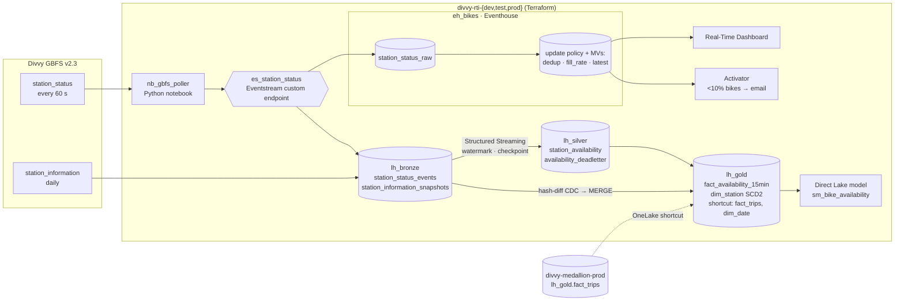

# Project plan & progress

**Progress: Step 6 done — 6 of 8 steps**

Fabric Real-Time Bike Availability: a streaming + CDC/SCD2 platform on the Divvy domain. Operations see which
Chicago stations are about to run empty or full, minutes ahead; analysts get station history (renames, capacity
changes, moves) that stays correct over time. It pairs with the batch medallion in
[fabric-medallion-cicd-terraform](https://github.com/felipecastro-data/fabric-medallion-cicd-terraform) on the same
domain (batch + streaming pair).

## Decisions taken (2026-11-11)

| Topic | Decision | Why |
|---|---|---|
| Poller runtime | Fabric **Python notebook** (non-Spark), loops ~55 min at 60 s, rescheduled hourly by Terraform | No Azure subscription on the tenant; stays 100% Fabric + Terraform |
| Workspaces | New `divvy-rti-dev/test/prod`, own HCP Terraform workspace `fabric-rti-platform`, own deployment pipeline | Repos stay independent; medallion Gold is read through OneLake shortcuts |
| Alert channel | Activator → **email** | Simplest to set up and evidence |
| Prod streaming window | **7 days 24/7**, then pause; dev/test run bounded sessions only | Trial capacity (FTL64, started 2026-10-13) likely ends ~2026-12-12 |
| CI identity | Reuse Entra app `sp-fabric-medallion-cicd`; add federated credentials for this repo | Already allowed by tenant settings + `sg-fabric-automation`; no secrets |

## Source facts (measured 2026-11-11, not assumed)

- GBFS discovery `https://gbfs.divvybikes.com/gbfs/gbfs.json` → Lyft-hosted `gbfs.lyft.com/gbfs/{1.1|2.3}/chi/`.
  Use **v2.3** (`vehicle_types_available`). `ttl = 60`, ETag + Last-Modified headers present.
- **2,079 stations** (not ~1,700): 1,178 `classic` + 901 `lightweight`. `station_status` 763 KB, `station_information` 1.1 MB.
- Volume if every station is pushed every poll: 2,079 × 1,440 ≈ **3.0M events/day, ~90M/month**. Real state
  changes (new `last_reported`) are far fewer — measure the dedup ratio and report both.
- Some stations report a `last_reported` from 2025 → stale reporters; flag them, don't drop them.
- **Join key to trips:** trip `start_station_id` (e.g. `CHI00307`) = GBFS **`short_name`**, not `station_id`
  (a 19-digit number). The 901 `lightweight` stations have **no `short_name`** → no trip join by key. Report coverage.

## Architecture



**Hot path (seconds):** poller → Eventstream → Eventhouse. KQL update policy computes `fill_rate =
bikes / (bikes + docks)` and flags; materialized views dedupe on `(station_id, last_reported)` and keep the latest
state per station. Retention 30 days, hot cache 7 days. Serves the dashboard and Activator.

**Warm path (minutes):** Eventstream → `lh_bronze.station_status_events` (Delta) → Spark Structured Streaming
(`withWatermark(event_time, "10 minutes")`, `dropDuplicatesWithinWatermark`) → `foreachBatch` MERGE into
`silver.station_availability` (idempotent per batch id) + `silver.availability_deadletter` (schema violations,
impossible counts, late beyond watermark, stale reporter). Gold: 15-min windows per station (avg fill rate, minutes
empty, minutes full).

**CDC / SCD2:** daily `station_information` snapshot → `sha2` hash-diff over tracked attributes (name, short_name,
capacity, station_type, location > 100 m) vs current versions → one Delta MERGE into `gold.dim_station`
(`valid_from` = GBFS `last_updated`, not load time). Removed stations close their version with reason `removed`.
This delivers the "revisit when" of medallion ADR 0004 (dating versions from a feed instead of load time).

**Serving:** Real-Time Dashboard (map by fill rate, near-empty list, events/s, latency p50/p95), Activator email
when a station drops below 10 % bikes (suppressed per station per hour), Direct Lake model joining
`fact_availability_15min` with medallion `fact_trips` through the `short_name` bridge.

## Repository layout (mirrors the medallion repo)

```
src/divvy_rti/        gbfs client, event schema, streaming transforms, scd2, dq, metrics (typed, tested)
tests/unit|dq|fixtures  pytest + chispa, local Spark + Delta, recorded GBFS fixtures (20 stations)
fabric/               Git-synced items: notebooks, SJD, Eventstream, KQL DB schema, dashboard, Activator, model
infra/terraform/      root + module; HCP Terraform state; microsoft/fabric ~> 1.15 (preview on for Activator)
tools/                fabric_ops, OneLake reader, latency report (reuse from the medallion repo)
docs/                 PLAN, design.md, adr/, screenshots/, charts/
.github/workflows/    ci, terraform, deploy (dev → test → prod), monitor
Makefile · .devcontainer · .env.example · pyproject.toml (uv, Python 3.11 = Fabric Runtime 1.3)
```

Terraform owns containers and schedules (workspaces, roles, lakehouses, Eventhouse, KQL DB, Eventstream shell,
shortcuts, Spark settings, deployment pipeline, job schedules, Activator). Git + deployment pipeline own code and
definitions (notebooks, KQL schema script, dashboard, semantic model). Same split as medallion ADR 0001.

## Steps

| # | Step | Status |
|---|------|--------|
| 1 | Foundations & spikes — repo skeleton, CI, OIDC for this repo, HCP workspace, 3 risk spikes | ✅ |
| 2 | Terraform — 3 workspaces, lakehouses, Eventhouse + KQL DB, Eventstream, shortcuts, deployment pipeline, TF CI | ✅ |
| 3 | Ingestion — GBFS client, poller notebook, daily `station_information` snapshot | ✅ |
| 4 | Hot path — Eventstream routing, KQL tables, update policy, MVs, retention | ✅ |
| 5 | Warm path — Structured Streaming Silver + dead-letter, Gold 15-min fact | ✅ |
| 6 | CDC / SCD2 — hash-diff `dim_station`, trips bridge, DQ gate | ✅ |
| 7 | Serving — Real-Time Dashboard, Activator email, Direct Lake model with `fact_trips` | ⬜ |
| 8 | CD, 7-day prod run, measured results, ADRs, design doc, README, pause | ⬜ |

Target dates (trial ends ~2026-12-12): steps 1–7 by **2026-11-27**, prod run **2026-11-28 → 12-05**, write-up and
pause by **2026-12-08**, buffer to trial end.

### Before Step 1 — manual, do first (you)
- [x] **Add GitHub OIDC federated credentials** to the Entra app `sp-fabric-medallion-cicd`:
      Entra admin center → App registrations → `sp-fabric-medallion-cicd` → Certificates & secrets →
      Federated credentials → Add credential → scenario **Other issuer** (not the GitHub template: this repo
      uses GitHub's *immutable* subject format, checked 2026-11-12), issuer `https://token.actions.githubusercontent.com`,
      audience `api://AzureADTokenExchange`. One credential per subject, prefix
      `repo:felipecastro-data@119976568/fabric-real-time-bike-availability@1454745081:` +
  - [x] `ref:refs/heads/main`
  - [x] `pull_request`
  - [x] `environment:dev`
  - [x] `environment:test`
  - [x] `environment:prod`
  - [x] `environment:platform` (Terraform apply, as in the medallion repo)

  These mirror the credentials already on the app for `fabric-medallion-cicd-terraform`.

### Step 1 — Foundations & spikes
- [x] `git init`, push skeleton to `felipecastro-data/fabric-real-time-bike-availability`; ruleset `protect-main` (PR, green `ci`, squash) — first `ci` run green 2026-11-12
- [x] `pyproject.toml` (uv, ruff, pytest, chispa, pyspark 3.5.5, delta-spark 3.2.1), `Makefile` (`make check`), devcontainer, `.env.example`, MIT license
- [x] `ci` workflow: ruff · pytest · Fabric item validator · wheel check · actionlint → single `ci` gate (green locally and on GitHub)
- [x] HCP Terraform workspace `fabric-rti-platform` (execution mode Local, `ws-A8VwDZqVFHCmHy2M`, same project as `fabric-medallion-platform`)
- [x] Spike workspace `divvy-rti-spike` (`4763d7f6-5e33-4995-8dfe-8671ea567351`, trial FTL64, West US) — **delete after Step 1**
- [x] Spike A: Python notebook sends a batch to an Eventstream custom endpoint with **Entra auth** (no connection string)
      ✅ 2026-11-12. `notebookutils.credentials.getToken("https://eventhubs.azure.net")` wrapped as an `azure-core`
      `TokenCredential` → `EventHubProducerClient(fully_qualified_namespace, eventhub_name, cred)`; 3/3 events read back
      (Mac with `AzureCliCredential` also 3/3). Namespace + hub come from the REST API
      `GET …/eventstreams/{id}/sources/{sourceId}/connection` (no keys needed). `azure-eventhub` is not preinstalled
      in the Python notebook (`%pip` or the wheel, see Spike B). Open: the run was as the user; scheduled prod runs
      run as the schedule owner → that identity needs workspace Contributor (check in Step 3).
- [x] Spike B: Python notebook can import the `divvy_rti` wheel (environment or `%pip` from `lh_bronze/Files`)
      ✅ 2026-11-12 with `%pip install /lakehouse/default/Files/wheels/<wheel>` (default lakehouse attached), run
      through the job API: `divvy_rti 0.1.0` imported from site-packages, Python 3.11.15. Upload = OneLake DFS
      create (needs `Content-Length: 0`) → append → flush. Environment route not tested (not needed). Job
      `failureReason` is generic ("statement execution failures") → spikes/smoke runs write results to `Files/`.
- [x] Spike C: Direct Lake model over a lakehouse **shortcut** to medallion `fact_trips`
      ✅ 2026-11-12. OneLake shortcut `lh_spike/Tables/fact_trips` → `divvy-medallion-prod/lh_gold/Tables/dbo/fact_trips`
      (non-schema lakehouse → SQL endpoint schema `dbo`; call `sqlEndpoints/{id}/refreshMetadata` after creating
      it). TMDL model with `directLakeBehavior: directLakeOnly` (fallback would error) created via REST, framed,
      DAX `COUNTROWS` = **6,006,901 = source rows** (delta-rs). Not tested: fixed-identity connection (SSO as the user
      worked) — revisit if the model is refreshed by the CI service principal.

### Step 2 — Terraform
- [x] Module `fabric_rti_stack`: workspace, admin role, `lh_bronze/lh_silver/lh_gold`, `eh_bikes` + `kqldb_bikes`, `es_station_status`, Spark settings
- [x] `fabric_shortcut` from `lh_gold` to `divvy-medallion-<env>` `fact_trips` and `dim_date` (medallion IDs looked up by name, not hard-coded)
- [x] Deployment pipeline Development → Test → Production (in code); repo variables `AZURE_*`, `FABRIC_CAPACITY_ID`,
      `FABRIC_ADMIN_USER_OBJECT_ID`, `FABRIC_SP_OBJECT_ID`; environments dev/test (main only) and prod/platform (approval)
- [x] Workspace/pipeline ID repo variables after the first apply (`FABRIC_WORKSPACE_ID_DEV/TEST/PROD`, `FABRIC_DEPLOYMENT_PIPELINE_ID`)
- [x] `terraform` workflow: fmt · validate · tflint · plan comment · approval-gated apply — first apply 2026-11-12:
      35 added as the service principal; all items + shortcuts verified in dev/test/prod
- [x] 0 drift after apply (local plan as the human admin + CI plan as the service principal, 2026-11-12).
      Quirk: the first `divvy-rti-test/es_station_status` was Active and readable by the service principal but
      `Unauthorized` and unlisted for the human Admin. Fixed by recreating it from CI: run `terraform` manually with
      `replace = module.workspace["test"].fabric_eventstream.this` (new id `609a37cc-…`).
- [x] Delete the temporary `divvy-rti-spike` workspace (2026-11-12)

### Step 3 — Ingestion
- [x] `gbfs.py`: discovery, conditional GET (ETag), skip unchanged `last_updated`, retries with backoff, typed event model
      (stdlib only; discovery `https://gbfs.lyft.com/gbfs/2.3/chi/gbfs.json`). Live check 2026-11-12: 2,079 events,
      0 rejected, second poll `304 Not Modified`.
- [x] Event envelope: `poll_id`, `polled_at`, `feed_last_updated`, `station_id`, counts, `last_reported`, `schema_version`
      (timestamps ISO-8601 UTC; optional GBFS counts are `null` when absent; bad stations → `Rejected` with reason code)
- [x] `es_station_status` custom-endpoint source `src_gbfs_poller` in Git (`fabric/es_station_status.Eventstream`), pulled
      forward from Step 4 so the poller can be tested end to end. Pushed to **dev** with `updateDefinition` (dev has no
      Git connection yet). Smoke 2026-11-12 from the Mac (`AzureCliCredential`): one live poll = 2,079 events sent and
      2,079 read back, no duplicates. **Batch cap 64 KB**: 256 KB and 1 MB batches failed with an AMQP "write operation
      timed out" (nothing landed); test/prod get the definition through the deployment pipeline.
- [x] `nb_gbfs_poller` (Python notebook; loop ~55 min, batched sends ≤ 64 KB, one JSON log line per poll, run summary in
      `lh_bronze/Files/runs/`). Loop logic in `divvy_rti.stream` (tested); custom endpoint found by name at run time, so
      no per-stage settings. Dev run as the user 2026-11-12 (3 min): 3 polls, 6,237 events sent, 0 failures.
- [x] Hourly `fabric_item_job_scheduler` (prod only) + daily `nb_bronze_station_information` schedule, both gated by
      `prod_poller_schedule_enabled` (default false: the notebooks reach prod through the deployment pipeline) and
      limited to `prod_poller_window` 2026-11-28 → 12-05.
- [x] **Service-principal run** 2026-11-12: `fabric-run` from `main` (dev, `nb_gbfs_poller`, 3 min) → 3 polls, 6,237
      events sent, 0 failures. `notebookutils.credentials.getToken` works for Event Hubs and the Fabric API when the job
      runs as the service principal (its run record has an empty `user`). Queue time before start: ~3 min.
- [x] Delete the probe notebook `nb_probe_tmp` in `divvy-rti-dev` (2026-11-12)
- [x] `nb_bronze_station_information`: daily snapshot, idempotent replace per `snapshot_date` (Chicago date), delta-rs,
      `dbo.station_information` + raw JSON. Dev 2026-11-12: two runs → 2,079 rows (not 4,158).
- [x] Wheel delivery: `tools/fabric_ops.py upload-wheel` → `lh_bronze/Files/wheels/`; notebooks `pip install` it at start
      (`azure-eventhub` comes in as a dependency). The `fabric-run` workflow uploads the wheel from its commit first.
      Lessons: OneLake paths need both IDs or both names (no mix); a new item can take ~2 min to appear in the item
      list; the job API failure text is generic, so notebooks write run records with tracebacks.
- [x] Tests on recorded fixtures (20 stations: 10 classic, 10 lightweight): parsing, unchanged-feed skip, retry, malformed station, real 304 path

### Step 4 — Hot path
- [x] Eventstream: (source done in Step 3) → Eventhouse `station_status_raw` (ProcessedIngestion) + Lakehouse
      `dbo.station_status_events` (flush ≤ 120 s). Destination IDs are placeholders (`{{workspace}}`,
      `{{KQLDatabase:kqldb_bikes}}`, `{{Lakehouse:lh_bronze}}`) that `fabric_ops.py push` resolves by name in the
      target workspace: Fabric rejects cross-workspace and all-zeros IDs. Dev 2026-11-12 (3-min poller run, 3 polls):
      6,237 rows in `station_status_raw` and 6,237 in the Lakehouse (3 commits, no duplicate poll × station), which landed with the event fields plus `EventProcessedUtcTime`,
      `PartitionId`, `EventEnqueuedUtcTime` (timestamps stay ISO strings in Bronze; Silver casts them).
- [x] KQL schema script `kql/schema.kql` (idempotent, applied with `fabric_ops.py kql`; not a Git `KQLDatabase` item,
      whose definition embeds the stage-specific `parentEventhouseItemId`): raw table, **non-transactional** update
      policy (fill rate, empty/full/offline/stale flags; streaming ingestion can't run a transactional policy that calls
      `ingestion_time()`), MVs `station_status_dedup` (`station_id, last_reported`) and `station_latest`, retention
      30 d / cache 7 d. Dev: enriched 6,237 = raw; dedup 3,569 (idle stations repeat); `station_latest` 2,079.
- [x] Latency functions `latency_by_hop()` / `throughput()`. Dev 2026-11-12 (3 polls, indicative only):
      poll → ingest p50 **1.4 s** / p95 **7.5 s**; feed → poll ~85 s; station → feed p50 127 s (p95 is months: idle
      stations, flagged `is_stale`); peak 69 events/s per minute. Prod 7-day numbers come in Step 8.
- [ ] **Step 8 follow-up:** placeholders don't survive Git sync / deployment pipeline → deploy the Eventstream with
      `fabric_ops.py push` per stage, and run `kql/schema.kql` per stage from CI as the SP (Kusto scope untested for the SP)

### Step 5 — Warm path
- [x] `divvy_rti/availability.py` (one module, not `silver/availability.py`): stateless, deterministic validation →
      `availability_deadletter` with reason codes `unsupported_schema`, `missing_field`, `bad_timestamp`,
      `negative_count`, `impossible_count` (e-bikes > bikes), `future_report` (> 5 min ahead of the poll), `late`
      (enqueued > 10 min after the poll). **Stale reporters are flagged (`is_stale`, > 1 h, same rule as KQL), not
      dead-lettered** (source fact above: flag, don't drop).
- [x] `foreachBatch` insert-only MERGE keyed by `(station_id, last_reported)` (first poll that saw it wins), partitioned
      by `report_date` with a literal partition list in the MERGE condition (prunes files); dead-letter MERGE keyed by a
      SHA-256 of the Bronze row → both replay-safe. Checkpoints in `lh_silver|lh_gold/Files/checkpoints/`.
- [x] Gold `fact_availability_15min` from **every valid poll**, not the deduped Silver (an idle station is still observed
      each minute): watermark 10 min on `polled_at`, `dropDuplicatesWithinWatermark(station_id, poll_id)`, 15-min
      windows, append mode (a window is written once the watermark passes its end). Polls are 60 s apart, so
      `minutes_empty/full/offline` = matching polls.
- [x] Trigger: `duration_minutes = 0` → `availableNow` (dev/test/CI); prod = hourly schedule (Terraform, same gate and
      window as the poller), `processingTime = 1 min` for 50 min, stop between batches (two runs never share a checkpoint).
      Local tests (Spark 3.5.5 + Delta 3.2.1): reason codes, dedup, Gold windows, **two-part run + replayed batch =
      one-shot run** (exactly-once), bounded trigger run.
- [x] Dev 2026-11-13 (`nb_silver_availability`, `availableNow`, as the user): Bronze 12,474 rows (6 polls) → **Silver 6,199
      = Bronze distinct `(station_id, last_reported)`**, dead-letter 0, 913 stale flagged; Gold 2,079 rows (the closed
      window; newer windows wait for the watermark). Run 1 read Bronze before the last poll's commits landed (≤ 120 s
      flush); run 2 resumed from the checkpoint and caught up. Fabric quirk: `createIfNotExists` on an existing OneLake
      path fails with `SCHEMA_NOT_FOUND` → check `isDeltaTable` first.

### Step 6 — CDC / SCD2
- [x] `divvy_rti/dim_station.py` → `lh_gold` `dbo.dim_station`: hash-diff (SHA-256 of name, short_name, capacity) +
      relocation > 100 m = type 2; coordinate drift ≤ 100 m, region, address, charging = type 1 (in place); stations
      missing from a snapshot closed with `end_reason = 'removed'`. One MERGE per snapshot; `valid_from` = GBFS
      `last_updated`. Pending snapshots applied oldest first; rerun = no-op; an older snapshot landing late is never
      applied after a newer one. Keys: durable `station_key` = hash(station_id), `station_version_key` = hash(station_id,
      valid_from). `station_type` is derived (`classic` with a `short_name`, else `lightweight`): the feed has no such field.
- [x] Bridge: `trips_station_key` = medallion `station_key` formula (`xxhash64(short_name)` masked), so
      `fact_trips.start_station_key` joins directly (no medallion `dim_station` shortcut). Dev 2026-11-13: **1,178 of
      2,079** stations have a key; **95.9 %** of Sept 2026 station trips (575,754 / 600,121) start at a current station.
- [x] `divvy_rti/dq.py` gate (`nb_gold_dim_station`, after the SCD2 load, results in `lh_gold` `dbo.dq_results`): SCD2
      unique version key, one current per station, contiguous intervals, open end ⇔ current; Bronze = Silver +
      dead-letter (both directions, rows polled > 60 min ago); dead-letter rate ≤ 1 %; Silver freshness ≤ 30 min (prod).
      Dev 2026-11-13: all gating checks pass. Prod schedule daily 06:30 Chicago (after the 06:00 snapshot), same gate.
- [x] **Bug fixed (Step 3):** `nb_bronze_station_information` used `write_deltalake(mode="overwrite", predicate=…)`;
      Fabric's older delta-rs **ignores the predicate** and replaced the whole table (dev lost the 2026-11-12 snapshot).
      Now delete-day + append, and the run fails if other days' row count changes. Reproduced locally (0.18.2 overwrites
      all; 1.1.4 respects the predicate; delete + append correct on both).
- [ ] **Check 2026-11-14:** next dev snapshot keeps 11-13 (`rows_other_days` = 2,079) and SCD2 applies a real day-2 diff
- [x] Service-principal run of `nb_silver_availability` from `main` (`fabric-run`, 2026-11-13): succeeded

### Step 7 — Serving
- [ ] Real-Time Dashboard `rtd_bike_availability` (in Git)
- [ ] Activator: fill rate < 10 % → email, one alert per station per hour
- [ ] Direct Lake `sm_bike_availability`: availability fact, SCD2 station (as-of), shortcut `fact_trips`, `dim_date`; measures (minutes empty, starts vs empties)

### Step 8 — CD, prod run, showcase
- [ ] `deploy.yml`: dev (Git sync) → test → prod (approval); bounded smoke run per stage
- [ ] Prod 24/7 for 7 days; `monitor` workflow opens a GitHub issue if the poller or stream stops
- [ ] Results: events/day raw vs dedup, events/s, latency p50/p95 per hop, dead-letter rate, SCD2 changes caught, CU use
- [ ] ADRs (below), `docs/design.md` (scalability, cost, governance, security), README with screenshots
- [ ] Pause: poller schedule off, stream stopped, Eventhouse retention left in place

## ADRs to write

1. Poller in a Fabric Python notebook vs Azure Function vs Eventstream HTTP source
2. Dual sink: Eventhouse (hot, KQL) + Delta (warm, Spark) — why both
3. Push full snapshots and dedupe downstream vs push changes only
4. SCD2 dated by GBFS feed time via hash-diff (supersedes the load-time dating in medallion ADR 0004)
5. Activator on a KQL query vs a stream rule in Eventstream
6. Terraform vs Git/deployment-pipeline ownership of Real-Time Intelligence items
7. Station key bridge: GBFS `short_name` ↔ trips `station_id`, and the 901 stations without one

## Risks

| Risk | Mitigation |
|---|---|
| Trial capacity ends ~2026-12-12 | Dated plan above; 7-day run; everything re-creatable by Terraform on a new trial |
| Custom endpoint Entra auth from a notebook doesn't work | Spike A first; fallback: connection string in a Fabric Variable Library marked internal (documented trade-off) |
| Poller gap at the hourly reschedule (~1 poll) | Measured and reported; dedup makes overlaps harmless |
| Direct Lake over shortcut falls back or fails | Spike C; fallback: copy `fact_trips` aggregates into `lh_gold` nightly |
| Activator Terraform resource is preview | Enable provider preview mode; fallback: Git-managed Activator item |
| CU burn from 24/7 streaming on 3 envs | Only prod runs continuously; dev/test use `availableNow` / bounded poller runs |
